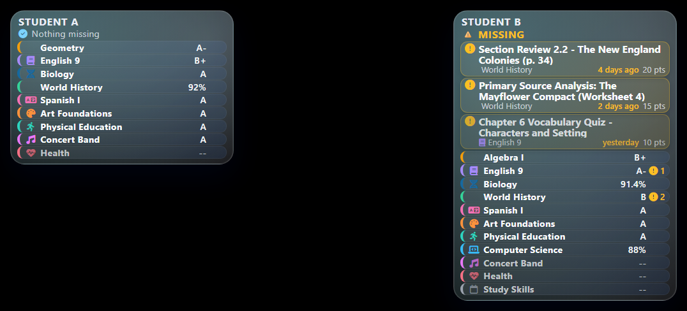

# MMM-CanvasGrades

A [MagicMirror²](https://magicmirror.builders) module for parents. It signs in to Canvas LMS as the parent (observer) account and shows each linked student's course grades and, above all, the work that is missing.



_Sample data. Student names, courses and grades are fictional._

## What it shows

For every student linked to the observer account:

- One row per course with the current grade (letter, percent or both) and a badge when work is missing.
- A "Missing" list, in both layouts: assignment name, course, due date relative to today ("due Tue", "3 days ago") and points, above the course rows. It is capped by `maxMissing`, and the rest show as "+N more".
- A small warning mark (an animated Lottie icon, or a pulsing icon) beside a student's missing list. It is decoration only; the text list carries the information.
- Optionally the most recent graded assignments, with late, excused and hidden markers.

The module always tells you which of these states it is in:

| State           | What you see                                                                                                                               |
| --------------- | ------------------------------------------------------------------------------------------------------------------------------------------ |
| Loading         | A dim "Loading grades..." line, until the first fetch finishes.                                                                            |
| OK              | Course rows, the missing list and (if enabled) recent grades.                                                                              |
| Nothing missing | Course rows and a calm "Nothing missing" line.                                                                                             |
| Stale           | The last data, dimmed, with a footer such as "Updated 2 h ago - Canvas unreachable". Data is never discarded because of a temporary error. |
| Partial         | Whatever loaded, with the footer "Some courses could not be loaded".                                                                       |
| Error           | One specific line (token rejected, Canvas unreachable, and so on). See [Troubleshooting](#troubleshooting).                                |

## Requirements

- MagicMirror² (2.33 itself needs Node 22.18 or newer). The module runs on any Node version from 20 up. Its one runtime dependency is `lottie-web`, used only for the animated warning mark.
- A Canvas parent (observer) account that can create an access token. Some schools disable user-generated tokens; if the "New Access Token" button is missing in step 2 below, ask the school.

## Installation

```sh
cd ~/MagicMirror/modules
git clone https://github.com/hearter20176/MMM-CanvasGrades
```

Then install the runtime dependency. This step is required for the Lottie warning animation (without it the module still works and falls back to the CSS pulse):

```sh
cd MMM-CanvasGrades
npm ci --omit=dev
```

Before you add a token, make sure the mirror is not reachable from networks you do not trust: in `config.js` keep `address: "localhost"` (or the mirror's own address) and set `ipWhitelist`. See [Who can talk to the module](#who-can-talk-to-the-module).

## Update

```sh
cd ~/MagicMirror/modules/MMM-CanvasGrades
git pull
npm ci --omit=dev
```

Run `npm ci --omit=dev` after every update too, so `lottie-web` matches `package-lock.json`. Restart MagicMirror² afterwards.

## Access token

1. Log in to Canvas as the parent (observer) account in a browser.
2. Open Account > Settings > Approved Integrations > New Access Token. Give it a purpose such as "MagicMirror" and, if the school allows, no expiry.
3. Copy the token. Canvas shows it only once.
4. Save it on the mirror in a file that only contains the token, and make the file private:

```sh
nano ~/MagicMirror/config/canvas-token
chmod 600 ~/MagicMirror/config/canvas-token
```

The module looks for the token in this order and uses the first one that is set:

1. `accessToken` in the module config.
2. `accessTokenFile` (a file inside the MagicMirror² `config` folder, named `canvas-token` or `canvas-token-<anything>`, absolute or relative to the MagicMirror² folder; any other file name or location is refused).
3. The `CANVAS_ACCESS_TOKEN` environment variable.

`config.js` is served to every browser that opens the mirror page, so a token written inline as `accessToken` is visible there. Prefer `accessTokenFile`. The file is read again on every update, so replacing the token takes effect without a restart. If you set `accessTokenFile` and the file cannot be read, the module reports an error rather than silently trying the environment variable.

## Configuration

Add the module to `config.js`. A compact column in a side region:

```js
{
  module: "MMM-CanvasGrades",
  position: "top_right",
  header: "Grades",
  config: {
    canvasUrl: "https://canvas.example.edu",
    accessTokenFile: "config/canvas-token",
    layout: "compact",
    maxMissing: 4,
    excludeCourses: ["1005"],
  },
},
```

One instance per student on one MagicMirror² page, in the two side regions (this uses the MMM-pages `classes` setting; leave `classes` out if you do not use pages). In portrait, each side column is about half of the 1080 px screen, so both use the compact layout, whose card is 465 px wide by default (set in px, not rem, so it does not change with MagicMirror²'s 20 px root font size; two cards fit side by side inside MagicMirror²'s stock 60 px page margins, and on a narrower screen the card shrinks to fit). If your page margins are smaller you can widen it, for example `.cg-root { --cg-compact-width: 496px; }` in `css/custom.css`. The width is the `compactWidth` option (px, 260 to 700, default 465); a top row that shares the screen width with a centred clock needs about 350 (see [Sizing a top row](#sizing-a-top-row-beside-a-clock)). The IDs are fictional:

```js
{
  module: "MMM-CanvasGrades",
  position: "top_left",
  classes: "page2",
  config: {
    canvasUrl: "https://canvas.example.edu",
    accessTokenFile: "config/canvas-token",
    students: ["2001"],
    layout: "compact",
    maxMissing: 4,
    showStudentName: true,
    cache: true,
  },
},
{
  module: "MMM-CanvasGrades",
  position: "top_right",
  classes: "page2",
  config: {
    canvasUrl: "https://canvas.example.edu",
    accessTokenFile: "config/canvas-token",
    students: ["2002"],
    layout: "compact",
    maxMissing: 4,
    showStudentName: true,
    cache: true,
  },
},
```

The "observee" IDs used by `students` are Canvas user IDs. While you are logged in to Canvas as the parent, open `https://canvas.example.edu/api/v1/users/self/observees` (with your school's address) in the same browser. The page lists each linked student with an `id`. Course IDs for `courses`, `excludeCourses` and `courseLabels` are the numbers in the course URL (`/courses/1001`).

### Options

| Option                   | Default     | Description                                                                                                                                                                                                                                                                                                                                                                                                     |
| ------------------------ | ----------- | --------------------------------------------------------------------------------------------------------------------------------------------------------------------------------------------------------------------------------------------------------------------------------------------------------------------------------------------------------------------------------------------------------------- |
| `canvasUrl`              | `""`        | Required. Your school's Canvas address, `https://` only. A trailing slash or `/api/v1` is removed for you.                                                                                                                                                                                                                                                                                                      |
| `accessToken`            | `""`        | Canvas token. Visible to browsers; prefer `accessTokenFile`.                                                                                                                                                                                                                                                                                                                                                    |
| `accessTokenFile`        | `""`        | Path to a file that contains only the token. It must be inside the MagicMirror² `config` folder and named `canvas-token` or `canvas-token-<anything>`; other files there (for example other modules' tokens) are never read.                                                                                                                                                                                    |
| `students`               | `[]`        | Canvas user IDs to show, in display order. Empty shows every linked student.                                                                                                                                                                                                                                                                                                                                    |
| `studentLabels`          | `{}`        | Map of Canvas user ID to a display label, for example `{ "2001": "A." }`.                                                                                                                                                                                                                                                                                                                                       |
| `nameDisplay`            | `"short"`   | `"full"`, `"short"` (Canvas short name), `"initials"` or `"none"`.                                                                                                                                                                                                                                                                                                                                              |
| `showStudentName`        | `"auto"`    | `"auto"` (only with more than one student), `true` or `false`.                                                                                                                                                                                                                                                                                                                                                  |
| `courses`                | `[]`        | Course IDs to include, in this order. Empty shows all active courses.                                                                                                                                                                                                                                                                                                                                           |
| `excludeCourses`         | `[]`        | Course IDs to hide, such as a homeroom.                                                                                                                                                                                                                                                                                                                                                                         |
| `courseLabels`           | `{}`        | Map of course ID to a short display name.                                                                                                                                                                                                                                                                                                                                                                       |
| `maxCourseNameLength`    | `24`        | Course names longer than this (8 to 80) are cut with "...".                                                                                                                                                                                                                                                                                                                                                     |
| `gradeDisplay`           | `"auto"`    | `"auto"` (letter if the course has one, else percent), `"letter"`, `"percent"` or `"both"`.                                                                                                                                                                                                                                                                                                                     |
| `scoreType`              | `"current"` | `"current"` (ungraded work ignored) or `"final"` (ungraded counts as zero).                                                                                                                                                                                                                                                                                                                                     |
| `gradingPeriod`          | `"current"` | `"current"` grading period or `"all"` (course total).                                                                                                                                                                                                                                                                                                                                                           |
| `showCourseGrades`       | `true`      | Show the per-course grade rows.                                                                                                                                                                                                                                                                                                                                                                                 |
| `hideUngraded`           | `false`     | `true` leaves out a course that has no grade to show (it would read "--") and no missing work. A course with missing work is always kept.                                                                                                                                                                                                                                                                       |
| `showMissing`            | `true`      | Fetch and show missing work.                                                                                                                                                                                                                                                                                                                                                                                    |
| `maxMissing`             | `8`         | Most missing rows per student (1 to 30, default 8); the rest show as "+N more". In the compact layout 4 keeps the card short enough to sit beside other side-column modules.                                                                                                                                                                                                                                    |
| `missingLookbackDays`    | `30`        | Ignore missing work due more than this many days ago. `0` means no limit.                                                                                                                                                                                                                                                                                                                                       |
| `inferMissing`           | `true`      | Also treat unsubmitted, past-due, online-submission work as missing when Canvas has not flagged it.                                                                                                                                                                                                                                                                                                             |
| `showRecentGrades`       | `0`         | Show the N most recently graded assignments per student (0 to 10). `0` is off.                                                                                                                                                                                                                                                                                                                                  |
| `recentGradesDays`       | `7`         | Only grades posted within this many days.                                                                                                                                                                                                                                                                                                                                                                       |
| `assignmentScoreDisplay` | `"auto"`    | `"auto"` (follow each assignment's grading type), `"points"`, `"percent"` or `"letter"`.                                                                                                                                                                                                                                                                                                                        |
| `layout`                 | `"full"`    | `"full"` for wide regions, `"compact"` for side columns (a 465 px card). Both layouts list the missing assignments by name; full adds recent grades.                                                                                                                                                                                                                                                            |
| `compactWidth`           | `465`       | Width in px (260 to 700) of the compact card. The default fits two cards side by side on a 1080 px portrait screen. A top row that shares the width with a centred clock needs about `350`; see [Sizing a top row](#sizing-a-top-row-beside-a-clock).                                                                                                                                                           |
| `subjectNameColor`       | `false`     | `true` also colours the course name text with the subject colour. Off by default, because MMM-MyAgenda's colours are tuned for icons: a dark one such as `#1569a0` is nearly unreadable as text on the night theme (contrast about 1.08:1).                                                                                                                                                                     |
| `subjectIcons`           | `{}`        | Icon per subject, in the same shape as MMM-MyAgenda's `iconMapping`. See [Matching MMM-MyAgenda subject icons and colours](#matching-mmm-myagenda-subject-icons-and-colours).                                                                                                                                                                                                                                   |
| `subjectColors`          | `{}`        | Colour per subject, in the same shape as MMM-MyAgenda's `keywordColors`. It colours the subject icon and a thin left border. See the same section.                                                                                                                                                                                                                                                              |
| `warningAnimation`       | `"lottie"`  | The warning mark beside a student's missing list: `"lottie"` (animated Meteocons icon), `"css"` (a slow CSS pulse of the warning icon) or `"none"`. `"css"` is also the automatic fallback when Lottie cannot load or motion is reduced.                                                                                                                                                                        |
| `warningLoop`            | `"loop"`    | `"loop"` plays continuously; `"once"` plays 3 times in total (the first play plus 2 loops) when the mark appears and whenever the data changes, then rests on the last frame. The option also applies to the CSS fallback: under `"once"` the pulse runs 3 iterations and then rests (class `cg-warn-once`). A suspended or hidden module pauses the pulse as well as the Lottie player (class `cg-suspended`). |
| `reduceMotion`           | `false`     | `true` forces the low-motion behaviour (no Lottie player, no pulse). The system "reduce motion" setting is honoured automatically.                                                                                                                                                                                                                                                                              |
| `updateInterval`         | `1800000`   | Milliseconds between updates (30 minutes). Minimum 5 minutes.                                                                                                                                                                                                                                                                                                                                                   |
| `requestTimeout`         | `20000`     | Milliseconds allowed per request (5000 to 30000; MagicMirror² itself cuts requests off after 30 seconds).                                                                                                                                                                                                                                                                                                       |
| `staleAfter`             | `0`         | Milliseconds after the last good update before data is marked stale. `0` means twice `updateInterval` plus 5 minutes.                                                                                                                                                                                                                                                                                           |
| `errorGraceSeconds`      | `120`       | A temporary error with no data yet keeps showing "Loading" for this long before an error is shown.                                                                                                                                                                                                                                                                                                              |
| `pauseBetween`           | `null`      | Quiet hours such as `["22:00", "06:00"]` (mirror local time). No updates inside the window; one runs when it ends.                                                                                                                                                                                                                                                                                              |
| `cache`                  | `false`     | Keep the last good data on disk so a restart during an outage shows stale data. The module chooses the file itself (`config/canvas-grades-cache-<id>.json`); it cannot be set.                                                                                                                                                                                                                                  |
| `locale`                 | `""`        | Language for dates and numbers, such as `"en-US"`. Empty uses the browser locale.                                                                                                                                                                                                                                                                                                                               |
| `timeFormat`             | `12`        | `12` or `24`, for due times.                                                                                                                                                                                                                                                                                                                                                                                    |
| `animationSpeed`         | `1000`      | Fade time in milliseconds when the display updates.                                                                                                                                                                                                                                                                                                                                                             |

Unknown values of the options the helper reads fall back to the default and a warning is written to the MagicMirror² log. The display-only options (`layout`, `showStudentName`, `timeFormat`, `errorGraceSeconds`, `animationSpeed`, `warningAnimation`, `warningLoop`, `reduceMotion`, `compactWidth`, `subjectNameColor`) fall back to their defaults silently.

## Matching MMM-MyAgenda subject icons and colours

Each course can show the same icon and colour that [MMM-MyAgenda](https://github.com/hearter20176/MMM-MyAgenda) uses for the same subject, so a subject looks the same on every page. Like MMM-MyAgenda, the colour is applied to the icon glyph and to a 4 px border on the left of the row; the title stays in the neutral text colour. Copy the two maps from your MMM-MyAgenda config (the example is fictional):

```js
{
  module: "MMM-CanvasGrades",
  position: "top_left",
  config: {
    canvasUrl: "https://canvas.example.edu",
    accessTokenFile: "config/canvas-token",
    layout: "compact",
    maxMissing: 4,
    subjectIcons: {
      Science: "fas fa-dna",
      Math: "bx bx-calculator",
      English: "fa-solid fa-book",
      History: "iconoir-globe",
      Music: "fa-solid fa-music",
    },
    subjectColors: {
      Science: "#1569a0",
      Math: "#c2410c",
      English: "#7c3aed",
      History: "#15803d",
      Music: "#be185d",
    },
  },
},
```

The rules are the ones MMM-MyAgenda follows:

- The match is against the course name as Canvas has it (before `courseLabels` or shortening), lower-cased, so `Science` also matches "AP SCIENCE 8".
- Each key is a substring match, tried in the order the keys are written, and the first key that matches wins. Put the specific key before the general one: `"Art History"` must come before `Art`.
- The icon and the colour are looked up separately, each by first match. The icon is the value of the first key of `subjectIcons` that matches. The colour is the value of the first key of `subjectColors`, in its own order, that matches; it does not have to be the same key as the icon, and a key that is only in `subjectColors` (no icon) works on its own. MMM-MyAgenda behaves the same way (its loop over `keywordColors` overrides the colour found under the icon key).
- "First" follows JavaScript property order: keys that look like whole numbers (such as `"101"`) come first, in ascending order, and every other key follows in the order you wrote it. Keys are only lower-cased, never trimmed, so `" Art "` (with spaces) matches only where those spaces appear.
- A course that matches nothing gets the module's default icon and colour. The missing and recent-grade lines show the icon and colour of their course.
- The keys never reach the browser; only the chosen icon classes and colour do.

Values are checked because they end up in the page. An icon must be a plain class list (letters, digits, spaces, `-` and `_`, up to 64 characters); Font Awesome animation classes (`fa-spin`, `fa-spin-pulse`, `fa-spin-reverse`, `fa-beat`, `fa-beat-fade`, `fa-bounce`, `fa-fade`, `fa-flip`, `fa-shake`, `fa-pulse`) are removed from it so a subject icon never animates. A colour must be `#rgb`, `#rgba`, `#rrggbb`, `#rrggbbaa`, a simple `rgb()`, `rgba()`, `hsl()` or `hsla()` (a `deg` unit on the hue is fine), or a plain colour name such as `teal` (not `inherit`, `initial`, `unset`, `revert`, `transparent` or `currentColor`). An invalid entry is dropped, and one warning per option is written to the MagicMirror² log (with counts, never the values).

Font Awesome icons (`fas fa-...`, `fa-solid fa-...`) always render, because MagicMirror² loads Font Awesome. Boxicons (`bx bx-...`) and Iconoir (`iconoir-...`) classes only render if some module on the page loads those icon fonts (MMM-MyAgenda does). Without them the space stays empty.

Colours are shown exactly as configured, so they match MMM-MyAgenda. The icon and the left border always use the exact colour. If you turn on `subjectNameColor` and a colour is hard to read as text, lower the CSS variable `--cg-subject-strength` (default `100%`), for example `.cg-root { --cg-subject-strength: 72%; }` in `css/custom.css`; it mixes the text colour toward white at night and toward black by day. Empty keys and keys longer than 80 characters are ignored (MMM-MyAgenda would treat an empty key as matching every title).

The front-end option `subjectNameColor` (default `false`) also colours the course name text. The CSS variable `--cg-subject-strength`, which you can set in `css/custom.css`, controls how strongly the subject colour is mixed toward white (night) or black (day) when it is used as text, for example `.cg-root { --cg-subject-strength: 70%; }`. It does not change the icon or the left border.

Set `hideUngraded: true` to drop courses that have no grade yet and no missing work, which shortens the card.

## Sizing a top row beside a clock

A card in `top_left` or `top_right` beside a centred clock has about 350 px of width, and if a dashboard sits below it the card has roughly 480 px of height before it overlaps. For that spot use `compactWidth: 350` together with `hideUngraded: true` and `maxMissing: 3` (or 4 only together with `hideUngraded`).

Measured heights at 350 px wide, with a 20 px root font size (MagicMirror²'s default):

| Content                                  | Height                              |
| ---------------------------------------- | ----------------------------------- |
| 9 courses, nothing missing               | 242 px                              |
| 11 courses (3 ungraded), 3 missing items | 456 px                              |
| 4 missing items and "+2 more"            | 529 px (467 px with `hideUngraded`) |

Budget about 480 px above a dashboard.

## Placement

The module is designed for the portrait corner and third regions: `top_left`, `top_right`, `bottom_left` and `bottom_right` with `layout: "compact"` (a 465 px card by default, set with the `--cg-compact-width` CSS variable; two fit side by side inside MagicMirror²'s stock page margins on a 1080 px screen), or `upper_third`, `middle_center` and `lower_third` with `layout: "full"` (up to about 1000 px wide). It is not intended for `top_bar`, `bottom_bar` or the fullscreen regions. Height is bounded by `maxMissing`, `showRecentGrades` and the number of courses.

## Warning animation and performance

The warning mark appears once per student, only while that student has at least one missing item. It is hidden from screen readers and never carries information by itself.

- With `warningAnimation: "lottie"` the module loads the bundled `lottie-web` player only when it is needed and uses `animations/code-orange.json` (about 3.5 KB). It never loads anything from the network.
- The player follows the same lifecycle as the other Glass modules, because leaked animation players can exhaust a mirror's CPU and memory: each render registers its containers, players are created only when the container is attached to the page, containers that have left the page are cleaned up and their players destroyed, nothing is destroyed during a render, players pause when MagicMirror² hides or suspends the module and resume when it returns, and everything is destroyed when the missing list disappears. There is at most one player per student and two per module instance, and no player is created while the module is hidden.
- If `lottie-web` is missing (you did not run `npm ci --omit=dev`) or fails to load, the module falls back to the CSS pulse once, with no retry loop.
- Reduced motion: with `reduceMotion: true`, or when the system reports "prefers reduced motion", no player is created and the mark is a static icon (`warningAnimation: "css"` becomes a static icon too). `warningAnimation: "none"` shows nothing.
- Use `warningLoop: "once"` on a small Raspberry Pi if you want the mark to rest most of the time.

## Third-party notice

The warning animation `animations/code-orange.json` is a copy of the "code-orange" icon from [Meteocons](https://github.com/basmilius/weather-icons) by Bas Milius, used under the MIT license (see `animations/LICENSE-meteocons.md`). The animation is played with [lottie-web](https://github.com/airbnb/lottie-web) (MIT). The version is pinned on purpose to exactly 5.10.2, the version all the Glass modules use, so the player lifecycle behaves the same in every module; `.github/dependabot.yaml` tells Dependabot to leave it alone. Upgrade it by hand, in all modules together.

## How missing work is decided

Canvas's own "missing" flag is trusted first. The module then applies these rules to each assignment, in order:

1. Excused work is never missing.
2. Work with an extension (late policy status "extended") is not shown as missing, because Canvas does not tell an observer when the extension ends.
3. Work Canvas flags as missing is missing, including work a teacher marked missing and work given zero by a missing-work policy.
4. Work that was later graded with a real score is shown as graded (a "late" marker appears in recent grades), not as missing, even if Canvas still carries the old flag.
5. Work whose grade has not been posted yet shows as "Hidden" and is not counted as missing.
6. With `inferMissing` on, an unsubmitted assignment that is past due, published, graded, and accepts online submissions is also treated as missing. This can show work a teacher collects in class but sets up as an online assignment; set `inferMissing` to `false` if that happens.
7. Assignments with no due date, "not graded" assignments, unpublished assignments and locked assignments are never inferred as missing.

Due dates are the student's own due date where Canvas provides one. Past-due comparisons use absolute time, and dates are shown in the mirror's local time. If Canvas's `missing_submissions` endpoint is available to your account it is combined with the above and duplicates are removed; if it is refused, the module quietly works from each course's submissions instead.

## Privacy

- The animation and its player are bundled and served by your own mirror; the module makes no request to any other site from the browser.

- The token is used only by the module's helper process on the mirror. It is never sent to the browser by the module, never written to the log and never written to the cache file.
- The browser receives a display-ready summary: names, grades and dates. It does not receive Canvas IDs, Canvas URLs or raw API responses.
- The log (info level) contains counts and state changes only. Student and course names appear only at debug level.
- Requests are sent only to the host in `canvasUrl`. Canvas pagination links that point to any other host are ignored, and redirects are refused.
- The optional cache file contains the same display-ready summary and is created with mode 600.

### Who can talk to the module

MagicMirror² lets any browser that can reach the mirror's port send the module messages, and the module cannot tell a genuine page from a hostile one. The module therefore limits what such a message can do:

- All stored tokens (`accessTokenFile` and `CANVAS_ACCESS_TOKEN` together) are bound to one Canvas host for the life of the process: the first registration with a usable token wins, and a later registration for any other host is refused, makes no request, and shows the configuration error. A token written inline as `accessToken` belongs to whoever supplied it and is not bound. To use a second school, run a second MagicMirror² instance.
- Set the `CANVAS_URL` environment variable to your school's address (strongly recommended). It is a hard pin: stored tokens are then only ever sent to that host, and there is no first-registration race.
- `accessTokenFile` must be inside the MagicMirror² `config` folder (symlinks are resolved, so a link pointing outside is refused) and must be named `canvas-token` or `canvas-token-<anything>`. The `config` folder often holds other secrets, such as a Home Assistant token; the name rule keeps a hostile message from pointing the module at them. The refusal is logged without reading or printing the file.
- No message can choose a file to write. The cache file name is derived by the module, only an existing valid cache file is ever replaced, and symlinks are not followed. After each write the module deletes its own older cache files that are no longer in use (valid cache files only; it keeps the newest 8 and removes any older than 30 days). The old `cacheFile` option is ignored (with a log warning); use `cache: true`.
- After an instance has registered, later messages cannot change its `canvasUrl` or token source. Restart MagicMirror² after editing those options.

Keep the mirror's port off untrusted networks: in `config.js` leave `address` at `"localhost"` (or set it to the mirror's own address) and set `ipWhitelist` to the machines that should reach it. These checks are a second line of defence.

## Troubleshooting

| What the mirror shows                                                   | Cause and fix                                                                                                                                                                                                                                                                                                                                                          |
| ----------------------------------------------------------------------- | ---------------------------------------------------------------------------------------------------------------------------------------------------------------------------------------------------------------------------------------------------------------------------------------------------------------------------------------------------------------------- |
| "Canvas URL or token not set"                                           | `canvasUrl` is empty or not an `https://` address, or no token is configured. The log names the option that is missing.                                                                                                                                                                                                                                                |
| "Canvas token file could not be read"                                   | `accessTokenFile` is missing, empty, unreadable, outside the `config` folder, or not named `canvas-token` / `canvas-token-<anything>`. The log gives the file name and reason (never its content). The module re-checks every update interval.                                                                                                                         |
| "Canvas URL or token not set" with a log line "canvasUrl refused"       | A stored token is already bound to a different Canvas host in this process, or `canvasUrl` does not match `CANVAS_URL`. Use the same host everywhere and restart MagicMirror² after changing it.                                                                                                                                                                       |
| "Canvas token rejected - generate a new one"                            | Canvas answered 401: the token was revoked, expired or mistyped. Create a new token and replace the file contents. The module notices the change without a restart and retries once every 6 hours otherwise.                                                                                                                                                           |
| "1 configured student not found" (or "2 configured students not found") | One or more IDs in `students` match no student linked to the account, so that child is not shown. Fix the ID (see [Configuration](#configuration)). The log names the IDs once, at warning level.                                                                                                                                                                      |
| "No linked students found for this account"                             | The observer account has no linked students, or none of the IDs in `students` match. When only some IDs in `students` match, the others are skipped and named in a log warning. Check the IDs as described under [Configuration](#configuration).                                                                                                                      |
| "Canvas denied access for this account"                                 | Canvas refused a required request (HTTP 403). The module retries every 6 hours. Check with the school that the observer link is active.                                                                                                                                                                                                                                |
| "Cannot reach Canvas"                                                   | Network, DNS, timeout or server error. It also appears when `canvasUrl` redirects (a vanity domain, `http` to `https`, a different path): the module refuses redirects so the token never leaves the configured host, and the log says so. Use the final `https` address shown in the browser's address bar. The module retries with growing delays (1 to 15 minutes). |
| "Canvas rate limit - retrying"                                          | Canvas throttled the token. The module backs off and retries; try a longer `updateInterval`.                                                                                                                                                                                                                                                                           |
| "Updated 3 h ago - Canvas unreachable"                                  | The data shown is the last good update, and the latest attempt failed.                                                                                                                                                                                                                                                                                                 |
| "Some courses could not be loaded"                                      | One or more courses refused or failed to return submissions. The rest are shown.                                                                                                                                                                                                                                                                                       |
| A grade shows "--"                                                      | The course hides final grades from observers, or Canvas returned no score yet.                                                                                                                                                                                                                                                                                         |
| A grade shows "total" next to it                                        | Between grading periods, so the course total is shown instead of a period grade.                                                                                                                                                                                                                                                                                       |

To get more detail, run MagicMirror² with debug logging enabled and look for lines starting with `[MMM-CanvasGrades]`.

## Tests

The tests use only Node's built-in test runner and need no packages:

```sh
cd ~/MagicMirror/modules/MMM-CanvasGrades
node --test test/*.test.js
```

To run the linters and formatters as well, install the development dependencies (Node 22 or newer for `node --run`):

```sh
npm install
node --run test
node --run check
```

## License

MIT. See [LICENSE](LICENSE).
